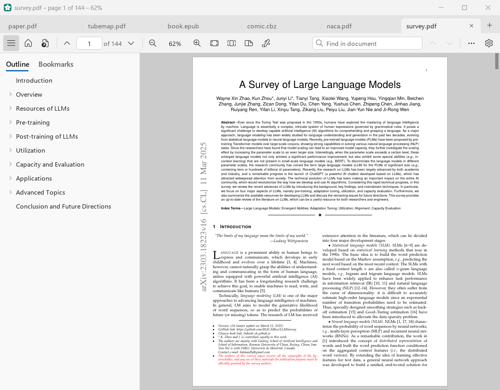
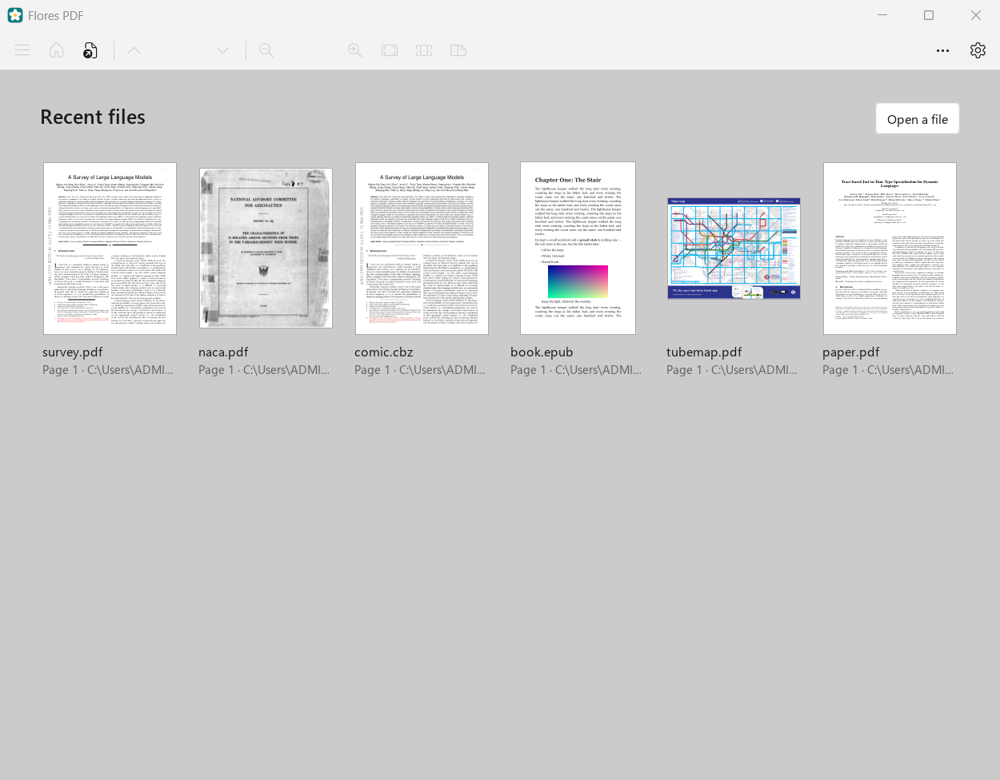
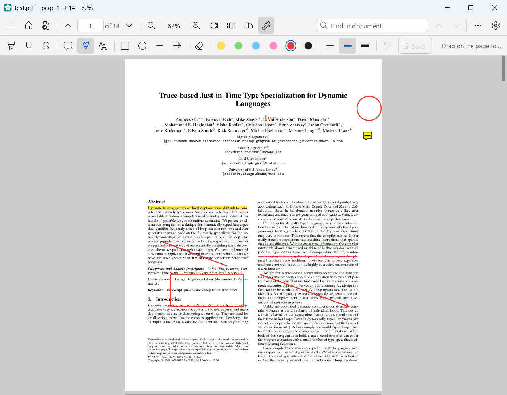
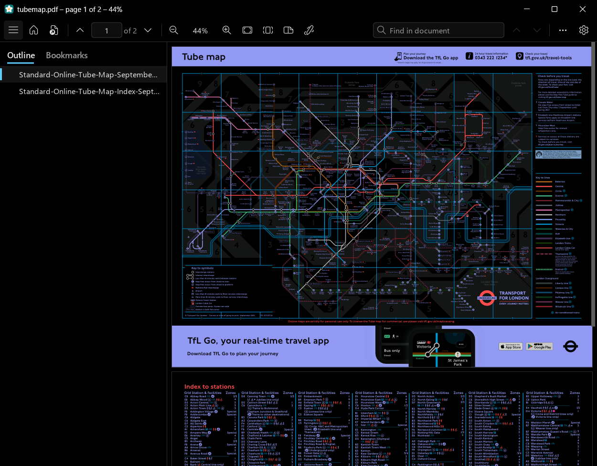
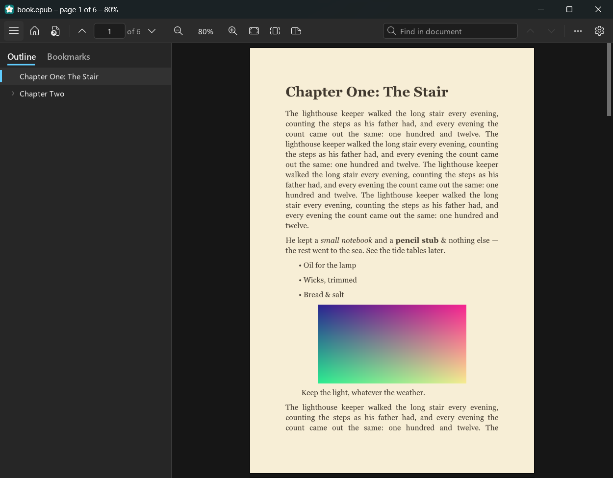
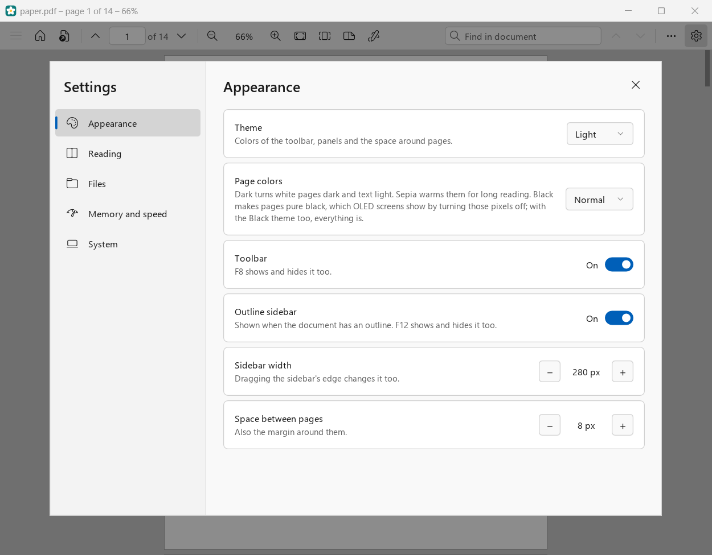

<p align="center">
  
</p>

<h1 align="center">Flores PDF</h1>

<p align="center">
  <b>A fast, light PDF reader for Windows, written in Rust.</b><br>
  Sumatra's speed and small footprint, with a modern interface, annotations, tabs and a true-black OLED theme.
</p>

<p align="center">
  <a href="https://github.com/AgastyaShenoy/flores-pdf/releases/latest"></a>
  <a href="https://github.com/AgastyaShenoy/flores-pdf/releases"></a>
  <a href="LICENSE"></a>
  <br>
  
  
  <a href="https://discord.gg/3xuJY8UXKu"></a>
</p>

<p align="center">
  <a href="https://github.com/AgastyaShenoy/flores-pdf/releases/latest"><b>⬇️ Download for Windows</b></a>
  &nbsp;·&nbsp; <a href="#-features">Features</a>
  &nbsp;·&nbsp; <a href="#-performance">Performance</a>
  &nbsp;·&nbsp; <a href="#%EF%B8%8F-keyboard-and-mouse">Shortcuts</a>
  &nbsp;·&nbsp; <a href="#%EF%B8%8F-build-from-source">Build</a>
</p>

<p align="center">
  
</p>

## 🌺 Why Flores PDF

[SumatraPDF](https://www.sumatrapdfreader.org) proved a PDF reader can be tiny and instant. Flores PDF (named after the island east of Sumatra; *flores* is Portuguese for flowers) keeps that spirit and adds what Sumatra's interface lacks:

- **🪶 As light as Sumatra, often lighter.** It holds 20–50% less memory than Sumatra on the same files ([measured](#-performance)), opens files as fast, and zooms with less CPU. Pages are drawn on the CPU and put on screen with GDI, as Sumatra does, so no graphics driver is ever loaded into the process.
- **✨ A modern, Windows 11-style interface.** Rounded toolbar with Fluent icons, tabs you can drag, a start page with thumbnails, a proper settings window, light, dark and true-black themes with a matching title bar.
- **✏️ Annotations that stay in the file.** Highlight, underline, strike out, draw, add notes and text boxes, and Ctrl + S writes them into the PDF, where Acrobat, Edge and every other reader see them.
- **🦀 Written in Rust.** Memory-safe parsing of untrusted files, and rendering spread over four threads where Sumatra uses one, so pages turn sharp sooner.
- **📦 One file.** `FloresPDF.exe` is the whole program (13 MB, nothing beside it), or an 8 MB installer that needs no admin rights. It updates itself from GitHub releases.
- **🔒 Private.** No accounts, no telemetry. The only request it makes is an optional check for a newer release.

## 📸 Screenshots

<table>
  <tr>
    <td width="50%"><p align="center"><b>Start page</b>: recent files with thumbnails</p></td>
    <td width="50%"><p align="center"><b>Annotations</b>, saved into the PDF</p></td>
  </tr>
  <tr>
    <td width="50%"><p align="center"><b>Black (OLED) theme</b>: pure black, colors kept</p></td>
    <td width="50%"><p align="center"><b>EPUB</b> in sepia, dark theme</p></td>
  </tr>
  <tr>
    <td colspan="2"><p align="center"><b>Settings</b>: every option explained, applied as you change it</p></td>
  </tr>
</table>

## ✨ Features

### 📚 Reads
- **PDF**, including password-protected files, through [hayro](https://github.com/LaurenzV/hayro)
- **EPUB** e-books, laid out as pages in Georgia, with their table of contents
- **DjVu**, with its text layer for search and selection
- **Comics**: CBZ, CBR and CB7
- **Pictures**: JPEG, PNG, GIF and WebP

### 🗂️ Getting around
- **Tabs** in one window: drag to reorder, middle-click to close, Ctrl + Shift + T to reopen
- **Start page** with a thumbnail of each recent file, and a Home button to get back to it
- Every file **reopens where you left it**, with its zoom, rotation and layout; last session's tabs come back
- **Outline sidebar**, and **bookmarks** you name yourself
- **Links** with a preview of where they go, and Back / Forward after a jump
- **Smooth scrolling**, a big easy-to-grab scroll bar, hold the right button and turn the wheel to zoom
- **One page, two pages or book view**, rotation, **presentation mode** and full screen

### ✏️ Annotations and forms
- **Highlight, underline, strike out** selected text (Ctrl + H, Ctrl + U)
- **Notes**, **text boxes**, **freehand pen**, **rectangles, ellipses, lines and arrows**, in six colors and three widths
- **Eraser**, undo, and removing annotations that were already in the file
- **Fill in PDF forms**: text fields, check boxes, radio buttons, drop-downs and list boxes
- **Ctrl + S saves into the PDF itself**; Ctrl + Shift + S saves a copy. Closing with unsaved changes asks first

### 🔎 Text
- **Search** with a running count of matches, highlighted as they're found
- **Select and copy text**; double-click for a word
- Find the selection in the document, or **search the web** for it

### 🎨 Looks
- **Light, dark, black (OLED)** or follow Windows
- **Page colors**: normal, dark (colors kept recognizable), sepia, or pure black
- Windows 11 look throughout: Segoe UI, Fluent icons, a dark or black title bar to match

### 🖨️ And the rest
- **Print**, copy a page as an image or save it as PNG
- **Reloads files that change** (handy with LaTeX), document properties
- **Installer for your account only**, no admin rights; registers for PDF, EPUB, DjVu and comics; uninstalls cleanly
- **Updates itself** from GitHub releases (can be turned off)
- Sumatra-style **command line**: `-page`, `-zoom`, `-print-to`

## ⚡ Performance

Measured against **SumatraPDF 3.5.2** on the same machine, same window size, same files, median of three runs. All numbers and methods are in [docs/architecture.md](docs/architecture.md) §9, with the raw data in [`bench/`](bench).

**Memory** (committed, MB; lower is better):

| | Flores PDF | Sumatra |
|---|---:|---:|
| No document | **7.9** | 11.3 |
| paper.pdf (14 pages of text) | **11.1** | 16.7 |
| paper.pdf after scrolling through | **14.5** | 27.4 |
| survey.pdf (144 dense pages) | **20.0** | 25.3 |
| survey.pdf after scrolling | **24.1** | 35.5 |
| naca.pdf (61 scanned pages) after scrolling | **19.3** | 38.3 |

**CPU** (seconds of CPU time; lower is better):

| | Flores PDF | Sumatra |
|---|---:|---:|
| Open paper.pdf | **0.14** | 0.23 |
| Open the London Tube map | **0.25** | 0.55 |
| Zoom in and out, paper.pdf | **0.16** | 0.30 |
| Zoom in and out, survey.pdf | **0.36** | 0.53 |
| 20 × Page Down, survey.pdf | 1.12 | **1.00** |
| 10 s idle | 0 | 0 |

In short: **less memory everywhere, opening and zooming as fast or faster**, and paging through costs 7–33% more CPU than Sumatra (it renders on four threads, so pages are sharp sooner). Zooming scanned pages is the one other place Sumatra is ahead. These were measured before the toolbar's newer features; the toolbar and settings cost under 1 MB.

### How it stays light
- Pages are cut into 512 px tiles, rendered by a pool of threads in order of what's on screen, and kept **compressed** in a cache with a byte budget
- A **display list** and **glyph cache** of our own make text pages about 40% faster to draw
- Files under 32 MB are read into memory, bigger ones mapped, like Sumatra; idle threads let go of their caches after 3 s
- **PDFium** (for forms and saving) is built into the exe compressed and only loaded the first time you save; reading never touches it
- The Windows segment heap hands freed memory back to Windows

## 💾 Install

1. Download **`FloresPDF-Setup.exe`** from the [latest release](https://github.com/AgastyaShenoy/flores-pdf/releases/latest) and run it. Windows may say the publisher is unknown, since it isn't code-signed: choose *More info*, then *Run anyway*.
2. It installs for your account only (no admin rights) in `%LOCALAPPDATA%\Programs\Flores PDF`, with a Start menu entry, and registers Flores PDF for PDF, EPUB, DjVu, CBZ, CBR and CB7 files.
3. At the end it offers to make Flores PDF your default PDF reader. Windows doesn't let programs do that themselves, so it opens Windows' Default apps page on Flores PDF: click **Set default**.

Uninstall from *Settings › Apps › Installed apps*. `FloresPDF-Setup.exe /S` installs silently.

**Portable:** `FloresPDF.exe` runs from any folder without installing. Put an empty `FloresPDF-settings.toml` beside it to keep its settings there too.

**Updates:** a few seconds after starting, Flores PDF asks GitHub whether there's a newer release; if so, an *Update to …* button appears in the toolbar. An installed copy downloads the new setup, closes, updates and opens again (after asking, and after any unsaved changes); a portable copy opens the release page. Turn it off under *Settings › System*.

## ⌨️ Keyboard and mouse

<details>
<summary><b>All shortcuts</b></summary>

| Action | Keys |
|---|---|
| Open a file in a new tab | Ctrl + O, or the + after the tabs |
| Home: the start page with recent files | Alt + Home, or the toolbar's house. Open tabs stay; click one, or its file's card, to go back |
| Next / previous tab | Ctrl + Tab / Ctrl + Shift + Tab, or Ctrl + Page Down / Page Up |
| Close the tab | Ctrl + W or Ctrl + F4, its ×, or a middle click on it |
| Reopen a closed tab | Ctrl + Shift + T, or right-click a tab |
| Move a tab | drag it |
| Right-click menu on the page | right-click without turning the wheel. With text selected: copy, highlight, underline, strike out, find it in the document, search the web for it. Over a web link: copy its address. On an annotation: edit a note's or text box's text, or delete it. Always: zoom, fit, bookmark the page, copy or save it as an image, print, save, save a copy, show in folder, copy path, properties |
| Right-click menu on a tab | close it, close the others or those to its right, reopen a closed tab, show in folder, copy file path |
| One page / two pages / book view | Ctrl + 6 / Ctrl + 7 / Ctrl + 8, or the toolbar's view button |
| Rotate left / right | Ctrl + Shift + − / Ctrl + Shift + + |
| Presentation | F5: click, →, Space or the wheel go on; right-click, ←, Backspace go back; Esc or F5 stop |
| Print | Ctrl + P; Esc stops a print job in progress |
| Bookmark the page, or remove its bookmark | Ctrl + D, then name it. Right-click a bookmark in the sidebar to rename or remove it |
| Highlight / underline the selected text | Ctrl + H / Ctrl + U, or right-click it (strike out too) |
| Annotate | the toolbar's pen: highlight, underline, strike out (drag across text), note and text (click, type, OK), pen, rectangle, ellipse, line, arrow (drag), eraser; six colors, three widths, undo (Ctrl + Z), Save. Esc puts the tool down |
| Fill in a form | the toolbar's pencil (PDFs with a form): click a field and type, Tab for the next |
| Save into the PDF / save a copy | Ctrl + S / Ctrl + Shift + S |
| Main menu | F10, or the ⋯ button |
| Scroll | mouse wheel, arrows, middle-button drag, or left-button drag away from text; Shift + wheel sideways |
| Move far, fast | drag the scroll bar's thumb, press anywhere on the bar to jump, or turn the wheel over it for a page per notch |
| Select text / copy | drag over it, double-click for a word, Ctrl + A for the page / Ctrl + C |
| Find | Ctrl + F, type; Enter / Shift + Enter or F3 / Shift + F3 for next and previous |
| Clear the selection, then the search | Esc |
| Screen down / up | Page Down / Page Up, Space / Shift + Space |
| Next / previous page | N / P, or → / ← when the page fits the width |
| Go to a page | Ctrl + G, or click the page number |
| Back / forward after a jump | Alt + ← / Alt + →, or the mouse's Back / Forward buttons |
| Sidebar (outline, bookmarks) | F12, or the toolbar's leftmost button; drag its edge to resize |
| First / last page | Home / End |
| Zoom in / out | hold the right button and turn the wheel, or Ctrl + wheel; + / − |
| Fit page / actual size / fit width | Ctrl + 0 / Ctrl + 1 / Ctrl + 2 |
| Settings | Ctrl + , (comma), or the gear |
| Toolbar | F8 |
| Full screen | F11 |
| Close the window | Q, or Ctrl + W with no tab open |

</details>

## ⚙️ Settings and your files

<details>
<summary><b>Where things are kept</b></summary>

Settings are in `%APPDATA%\FloresPDF\settings.toml`, a plain text file with each setting explained, editable from *Settings › System*. A `FloresPDF-settings.toml` next to `FloresPDF.exe` is used instead, for a portable copy. Beside it (with a `FloresPDF-` prefix when portable):

| File | What's in it |
|---|---|
| `history.txt` | Recent files, where you were in each, and which tabs were open. Turning off *Remember opened files* deletes it |
| `favorites.txt` | Bookmarks: page and name |
| `highlights.txt` | Highlights of e-books, DjVu and comics, which can't hold them |

Thumbnails for the start page are cached in `%LOCALAPPDATA%\FloresPDF\thumbnails`, and PDFium is unpacked to `%LOCALAPPDATA%\FloresPDF` the first time it's needed. A password typed for a protected PDF is kept in memory for that tab only, never written anywhere.

</details>

## 🛠️ Build from source

Needs Windows, the MSVC build tools and Rust (1.99 is pinned in `rust-toolchain.toml`).

```bash
cargo build --release -p flores-pdf
```

```bash
cargo build --release -p flores-setup
```

The setup packs the `FloresPDF.exe` it finds in the same target folder, so build the app first. A release build takes a few minutes, since it's optimized as one unit (fat LTO).

<details>
<summary><b>Project layout</b></summary>

| Crate | What it does |
|---|---|
| `crates/engine` | The `Engine` trait, the PDF adapter (links, outline, properties, passwords, annotations), EPUB, DjVu, comics and pictures, display lists, glyph and image caches, and hayro's renderer layer (vendored in `src/raster`) |
| `crates/render` | Page layout (spreads, rotation), tile cache, render threads, compositor, page colors, the text thread for search and selection |
| `crates/app` | The window, tabs, toolbar, sidebar, menus, start page, settings window, annotations, forms and saving through PDFium, printing, updates (`FloresPDF.exe`) |
| `crates/setup` | `FloresPDF-Setup.exe`: holds the app, compressed, and installs it for the current user |
| `crates/android` | `libflores.so`: the engine and renderer behind JNI for the Android app, drawing straight into its surface |
| `android/` | The Android app (Kotlin, platform views only, no AndroidX) |
| `third_party/pdfium` | PDFium build 7881 for Windows x64, with its licenses; packed into the exe by the app's build |
| `bench/` | Engine, memory and CPU benchmarks |

Design notes, every measurement and what was tested are in [docs/architecture.md](docs/architecture.md).

</details>

<details>
<summary><b>Publishing a release</b></summary>

Set `version` in `Cargo.toml`, build both exes, and attach `FloresPDF-Setup.exe` and `FloresPDF.exe`, named exactly so, to a GitHub release tagged `v` plus the version (for example `v1.2.0`). Every copy older than the tag then offers the update.

</details>

## 📱 Android

An early Android version lives in `android/`, for Android 8 and later. It renders pages with the same engine and renderer as the Windows app: the tiles, render threads, display lists and glyph cache, and the Normal, Dark, Sepia and Black page colors. The GPU (OpenGL ES) puts the rendered tiles on screen, so scrolling keeps up with the display's full refresh rate: a steady 144 fps on a Xiaomi Pad 6. Around the pages is a plain Android UI:

- PDF, EPUB, DjVu, CBZ and CB7 comics, and pictures, from the system's file picker or from other apps. CBR comics aren't supported yet, because UnRAR's build can't cross-compile from Windows.
- Smooth scrolling and flinging, pinch and double-tap zoom, and a page slider.
- Contents, links (Back returns from them), search with every match highlighted, and go to page.
- Recent files reopen where you left them. Password-protected PDFs ask for the password. The volume keys turn pages.

Annotations, forms, printing and settings are Windows-only for now.

To build it you need the Android SDK and NDK (Android Studio installs both) and Rust's Android targets:

```bash
rustup target add aarch64-linux-android x86_64-linux-android
```

```bash
powershell -File android/build-rust.ps1
```

```bash
cd android && ./gradlew assembleRelease
```

The APK is `android/app/build/outputs/apk/release/app-release.apk`, signed with the debug key so it installs for testing. For the emulator, add `-Pemulator` to include the x86-64 engine.

## 💬 Community

Made by **aga2522**. Questions, ideas and bug reports are welcome on the [Discord server](https://discord.gg/3xuJY8UXKu) (a general server, all welcome) or in [GitHub issues](https://github.com/AgastyaShenoy/flores-pdf/issues).

## 📄 License

Flores PDF is under the [MIT license](LICENSE). What it includes keeps its own license: hayro and its renderer, Apache-2.0 or MIT; PDFium, BSD-3-Clause, with the licenses of its parts in `third_party/pdfium`; UnRAR, under the UnRAR license, which allows reading RAR files but not making them; and the other Rust crates under theirs, listed in *About*.
